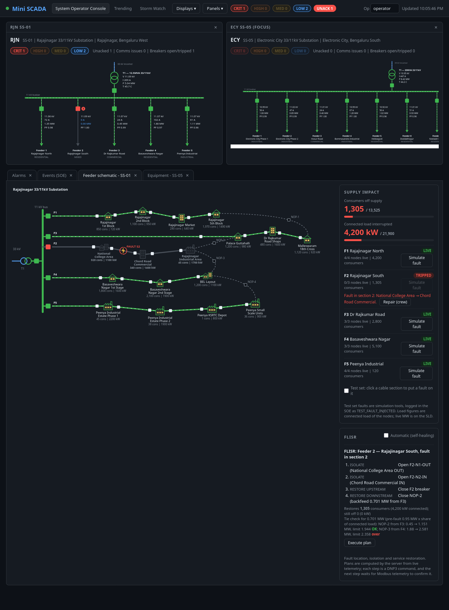
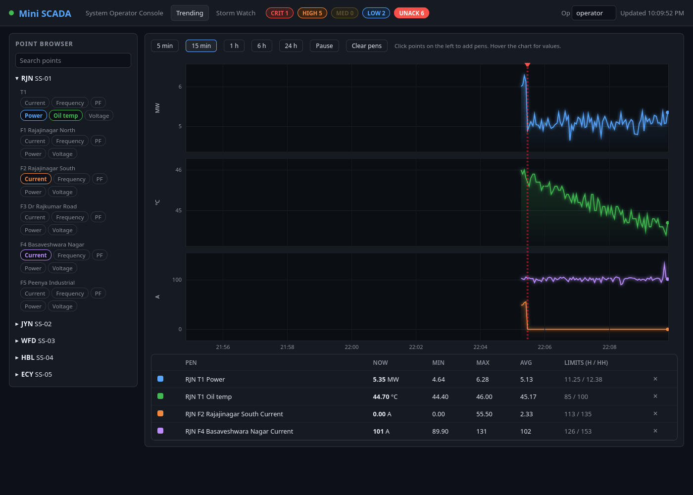
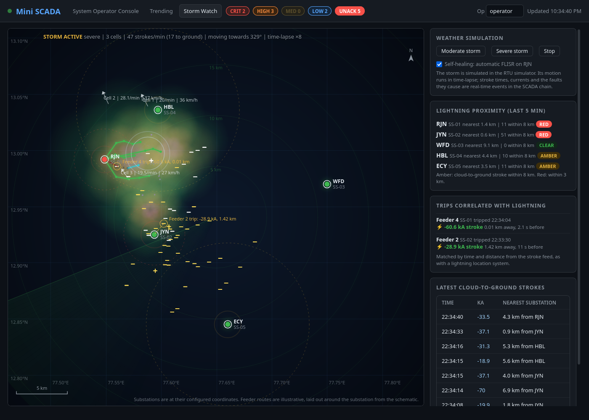
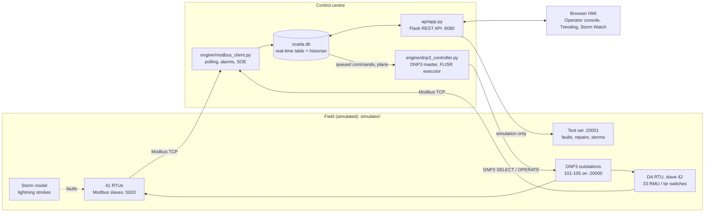

# Mini SCADA: a distribution SCADA/DMS simulation on RHEL 10

A working model of an 11 kV distribution control room, built to learn and demonstrate how
SCADA, DMS and OMS functions fit together: field telemetry over **Modbus TCP**, breaker and
switch control over **DNP3** (select-before-operate), a four-level alarm engine, a historian,
a sequence-of-events log, **FLISR** (fault location, isolation and service restoration) on an
RMU feeder network, and an operator console in the browser.

Five 33/11 kV substations in Bengaluru are simulated with 41 field devices plus a
distribution-automation RTU for 33 ring-main-unit and tie switches. **All data is simulated**:
the substation names and locations are real places, but no utility data is used.



---

## What it does

**Monitoring and alarms**
- An RTU simulator acts as 41 Modbus slaves (5 transformers, 36 feeders). The SCADA client polls
  all of them every ~3 s with block reads.
- The electrical model is consistent: feeder current = P / (√3·V·pf), and transformer P and Q =
  the sum of its feeders plus losses. Oil temperature follows loading with a thermal lag.
- Four limits per analog point (HIGH-HIGH, HIGH, LOW, LOW-LOW), each with its own priority.
  CRITICAL and HIGH alarms must be acknowledged and then cleared by an operator, and stay visible
  as "returned to normal" until they are. MEDIUM and LOW alarms clear themselves.
- Failure detection:
  - OFFLINE: the device answers Modbus exception 0x0B.
  - FREEZE: a value is stuck.
  - BREAKER TRIP.
  - UNAUTHORISED CONTROL: a breaker opened with no operator command. Modbus has no
    authentication, so this is detection, not prevention.
- Real-time table plus historian (30 h retention), and a sequence-of-events log.

**Control**
- Breaker and switch commands go out over DNP3 as SELECT then OPERATE, with a two-click
  confirmation in the HMI, a 30 s command expiry and a full audit trail.
- DMS interlocks refuse any operation that would energise a faulted section or connect two
  feeders in parallel.

**Distribution management (SS-01 Rajajinagar)**
- A feeder network of 17 load nodes, each a ring main unit with incoming and outgoing switches,
  plus 4 normally-open ties. The relay's fault locator reports the faulted cable section.
- **FLISR** opens the switches on both sides of the faulted section, recloses the feeder breaker,
  and backfeeds the customers beyond the fault through a tie. That last step only happens if the
  neighbouring feeder can carry the load: the planner checks its pre-fault load from the
  historian against the neighbour's emergency rating. If the whole section is too much, it
  restores the part that fits.
- Every step is a DNP3 command, and the next step waits until Modbus telemetry confirms the
  switch moved. Plans run in manual mode (operator approves) or automatic mode (self-healing).
  After a crew repair, a restore-normal plan returns the network to its normal configuration.

**Operator HMI** (one page, three consoles)
- **System Operator Console**: substation single-line diagrams and panels (Alarms, Events,
  Feeder schematic, Equipment) that you drag in from menus. One item fills the width, two sit
  side by side, three or more become tabs.
- **Trending**: up to 8 live pens in stacked strips per unit, with limit lines and markers for
  trips and faults.
- **Storm Watch**: a simulated thunderstorm drifts across the city map. Cloud-to-ground strokes
  near a cable can fault it, and FLISR responds. Each substation gets a lightning proximity
  warning, and breaker trips are correlated with strokes by time and distance, as utilities do
  with lightning-location data.

| Trending | Storm Watch |
|---|---|
|  |  |

---

## Architecture



**Monitoring path:** simulator → Modbus TCP → client → `scada.db` → API → HMI.
**Control path:** HMI → API (queues a command) → controller → DNP3 → outstation → breaker or
switch → seen on the next Modbus poll.

---

## What is real and what is simulated

| Implemented the way a real system does it | Simulated or simplified |
|---|---|
| Modbus TCP polling, 0-based register addressing, exception responses | The field devices, their load curves and failures |
| DNP3 link/transport/application framing with CRCs, CROB SELECT/OPERATE, checked against Wireshark's DNP3 decoder | DNP3 is a **subset**: no event polling, unsolicited responses, time sync or Secure Authentication |
| Alarm lifecycle with acknowledge, clear and returned-to-normal states | SOE timestamps are poll times (~3 s resolution), not device time stamps |
| FLISR sequencing with telemetry confirmation per step, interlocks, partial restoration | FLISR capacity check compares MW totals; there is no load flow or voltage-drop check |
| Lightning proximity and trip/stroke correlation by time and distance | The storm (motion runs in 8× time-lapse) and the SS-01 feeder routes, which are illustrative |
| Restricted service user, firewalld, systemd services | The operator name is free text: there is no login |

---

## Protocol reference

**Modbus** (every slave; wire address in brackets, as Wireshark shows it)

| Register | Value |
|---|---|
| 40001 (0) | Voltage, kV × 100 |
| 40002 (1) | Current, A × 10 |
| 40003 (2) | Power, MW × 100 |
| 40004 (3) | Power factor × 100 |
| 40005 (4) | Oil temperature, °C × 10 (transformers) |
| 40006 (5) | Frequency, Hz × 100 |
| 40007 (6) | Fault section from the relay's fault locator (0 = none) |
| 40100 (99) | Breaker: 0 OPEN, 1 CLOSED, 2 TRIPPED |

Slave ids: SS-01 1–6, SS-02 7–13, SS-03 14–21, SS-04 22–30, SS-05 31–41 (transformer first),
DA RTU 42 (one register per switch, 1 = closed).

**DNP3**: master address 1, outstation 100 + substation number (SS-01 = 101). Point 0 is the
transformer breaker, point N is feeder N's breaker, and points 10–42 are SS-01's switches.
CROB code 0x81 = trip/open, 0x41 = close.

To watch the traffic: capture on the loopback interface `lo` with the capture filter
`tcp port 5020 or tcp port 20000`, then decode port 5020 as Modbus/TCP. DNP3 on port 20000 is
recognised automatically.

---

## Running it

Requires Python 3.12 and **pymodbus 3.6.9**. Version 3.13 changed the datastore API, so stay on
3.6.9.

```bash
git clone https://github.com/AkashKS04/mini-scada.git
cd mini-scada
pip3 install -r requirements.txt
```

Start the four processes from the repository root, in this order, in separate terminals:

```bash
python3 simulator/modbus_server.py     # RTUs, DNP3 outstations, test set, storm model
python3 engine/modbus_client.py        # polling, alarms, historian (creates scada.db)
python3 engine/dnp3_controller.py      # DNP3 master, FLISR plan execution
python3 api/app.py                     # REST API + HMI on http://127.0.0.1:8080
```

For a permanent setup, `systemd/` has the four unit files used on the RHEL 10 host. They run
under a restricted `scada` user, with firewalld limiting the ports to localhost; see
[docs/security-hardening.md](docs/security-hardening.md).

### A five-minute demo
1. **Operator Console**: open RJN, then add the Feeder schematic and Events panels from **Panels**.
2. Click **Simulate fault** on a feeder. The breaker trips, the fault is located and the outage
   spreads along the map. Read out the FLISR plan and its capacity check, then **Execute plan**.
3. Click **Repair (crew)**, then run **Restore normal**.
4. **Trending**: show the trip, the transformer stepping down and the oil cooling.
5. **Storm Watch**: tick **Self-healing**, start a **Severe storm**, and watch a lightning stroke
   fault a cable and FLISR restore it without anyone touching it.

---

## Project layout

```
simulator/   modbus_server.py (RTUs, DNP3 outstation, test set), storm.py (weather model)
engine/      modbus_client.py (SCADA polling, alarms), dnp3_controller.py (control, FLISR)
api/         app.py (Flask REST API)
lib/         dnp3lite.py (DNP3 subset), topology.py (network model), flisr.py, geo.py
config/      substations.json, the single source of truth for devices, limits and the network
templates/   hmi.html (page shell)
static/      css/ and js/ for the three consoles
systemd/     service unit files
docs/        security hardening notes, screenshots
```

---

## Possible next steps

- Login and roles for the HMI, so control actions are tied to an authenticated operator.
- DNP3 event polling with outstation time stamps, for true millisecond SOE.
- State-based alarm suppression for equipment that is out of service.
- A load-flow based capacity check for FLISR.

---

## About

Built by **Akash** (ACSIS) on Red Hat Enterprise Linux 10 to learn how SCADA, DMS and OMS
systems work end to end, from protocols and process management to the operator's screen.
Started May 2026.
